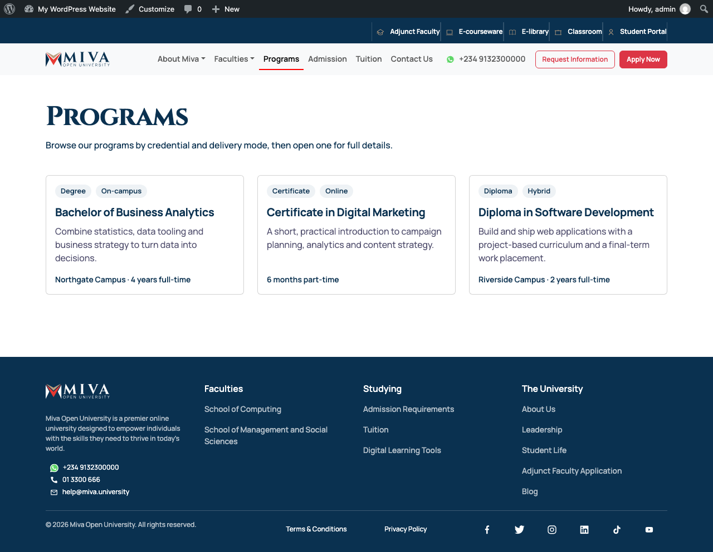
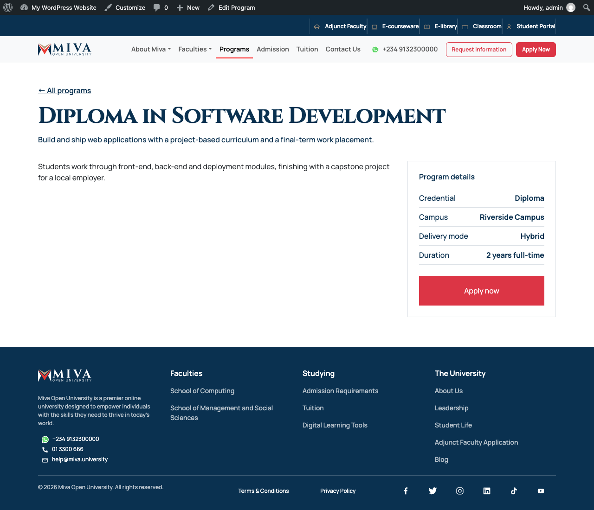
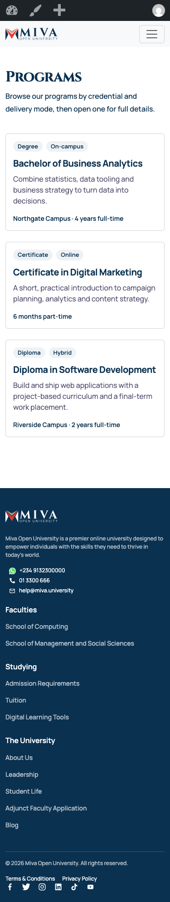
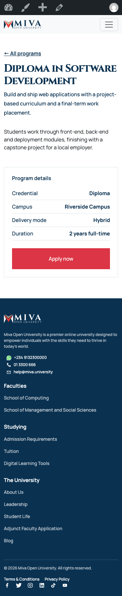
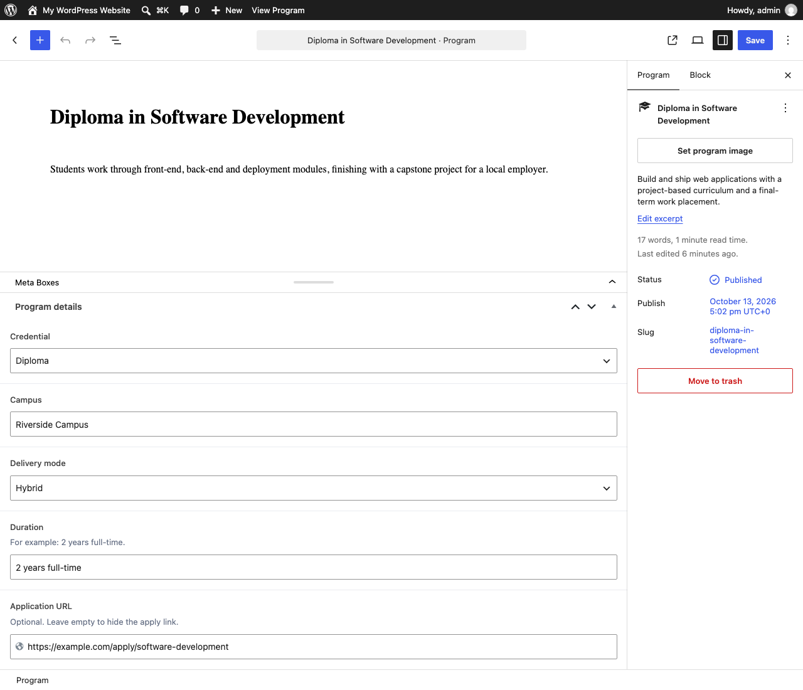
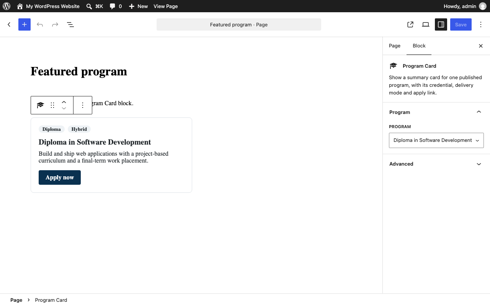
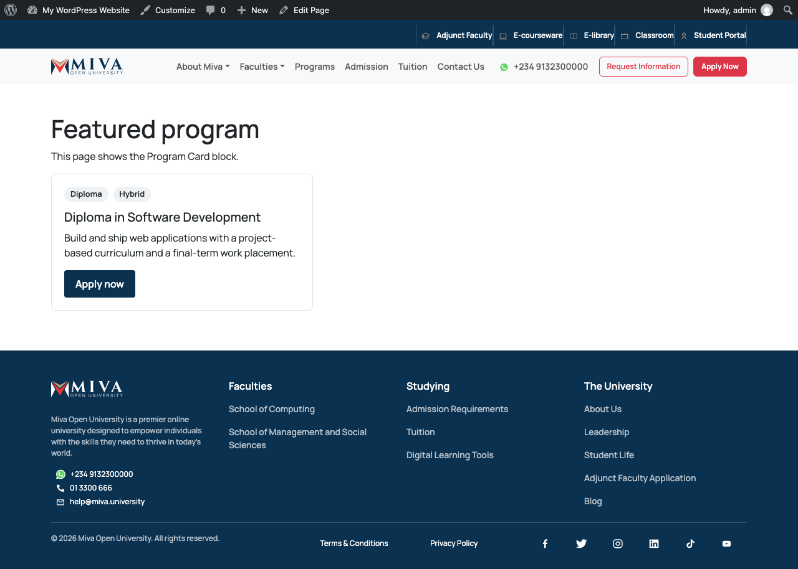
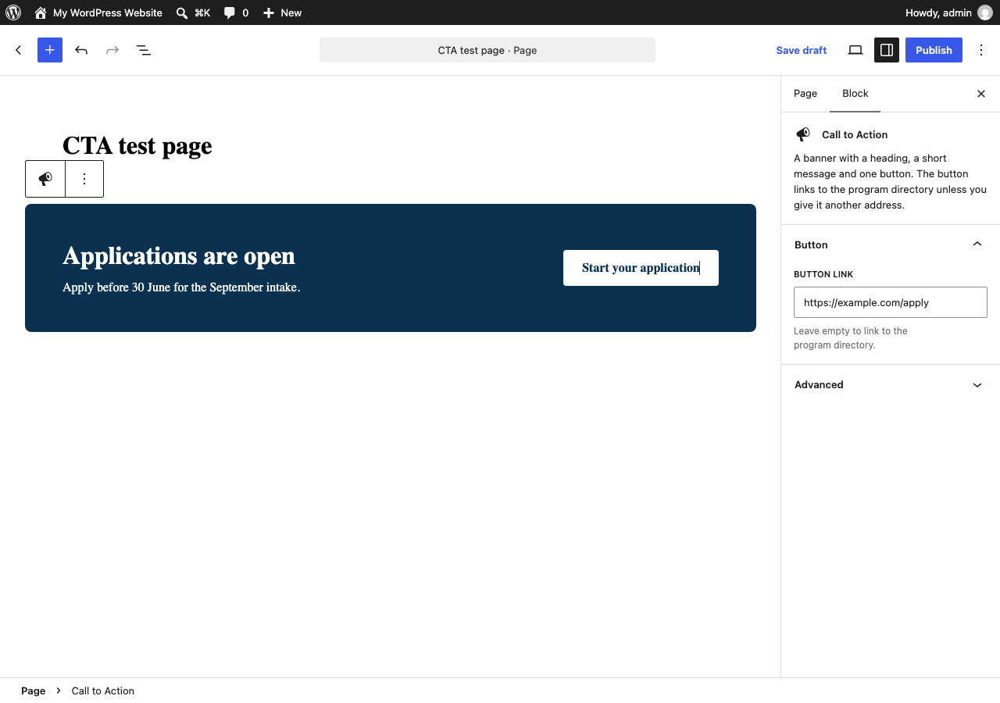
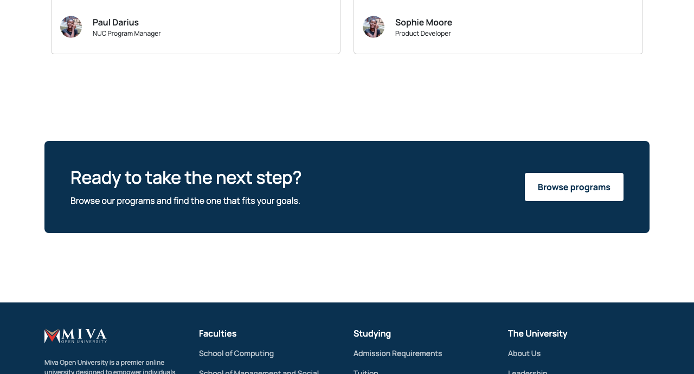
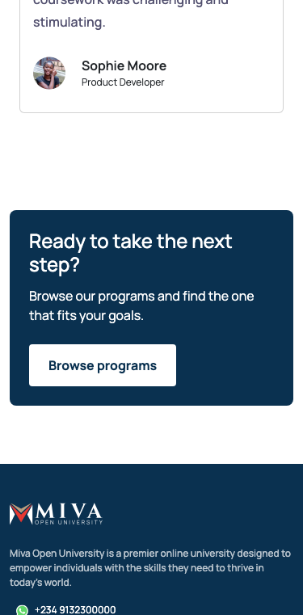

# Miva

A small WordPress proof of concept. An editor manages college programs in the admin; visitors browse them in a responsive directory. It demonstrates a classic PHP theme, a standalone plugin, a custom post type, Advanced Custom Fields integration and a custom Gutenberg block.

## Features

| Area | What it does | Where |
|---|---|---|
| Theme | Classic PHP theme: landing page, program directory, program detail page | `theme/` |
| Plugin | **College Programs**: owns the content model, independent of the theme | `custom-blocks/college-programs/` |
| Post type | `program`, with archive at `/programs/` and REST support | `includes/post-types.php` |
| ACF fields | Credential, campus, delivery mode, duration, application URL | `includes/fields.php` |
| Block | **Program Card**: pick a program, get a server-rendered card | `blocks/program-card/` |
| Block | **Call to Action**: a banner with a heading, a message and one button | `blocks/cta/` |
| Templates | `archive-program.php`, `single-program.php`, `template-parts/program-card.php` | `theme/` |
| Scholarships | `archive-scholarship.php`: card grid at `/scholarships/` with featured images; `single-scholarship.php`: detail page | `theme/` |

## Requirements

- WordPress 6.3 or later
- PHP 7.4 or later
- [Advanced Custom Fields](https://wordpress.org/plugins/advanced-custom-fields/) (the free version; no PRO features are used)

The theme loads three things from public CDNs: Bootstrap 5.3.1 and animate.css 4.1.1 (both pinned, with Subresource Integrity hashes) and the Cinzel and Manrope fonts from Google Fonts.

## Installing in a real WordPress site

The theme and the plugin are separate packages in this repository: `theme/` and `custom-blocks/college-programs/`. Each is installed on its own.

### upload zips in the admin

Build the two zips from the repository root:

1. **Theme**: Appearance → Themes → Add New → Upload Theme → choose `dist/miva.zip` → Activate **Miva Clone**.
2. **Plugin**: Plugins → Add New → Upload Plugin → choose `dist/college-programs.zip` → Activate **College Programs**.

Keep the zip named `miva.zip`: its files sit at the top level, so WordPress names the theme folder after the zip.

### After activating

Activation registers the post type and flushes rewrite rules, so `/programs/` works straight away. If it returns a 404, visit Settings → Permalinks and press Save. Pretty permalinks must be enabled (any structure other than "Plain").

### ACF

Install and activate **Advanced Custom Fields** from Plugins → Add New. There is nothing to import: the plugin registers its field group in PHP with `acf_add_local_field_group()`, so a "Program details" box appears on every Program edit screen.

If ACF is not active, the site keeps working and an admin notice on the Plugins and Programs screens explains what is missing.

## Creating and viewing programs

1. Go to **Programs → Add New**.
2. Enter a title, some body content and an excerpt (the excerpt is the card summary).
3. Fill in **Program details** below the editor. Every field is optional.
4. Optionally set a program image (featured image).
5. Publish.

| Field | Name | Type |
|---|---|---|
| Credential | `program_credential` | Select: Certificate, Diploma, Degree |
| Campus | `program_campus` | Text |
| Delivery mode | `program_delivery_mode` | Select: On-campus, Online, Hybrid |
| Duration | `program_duration` | Text |
| Application URL | `program_application_url` | URL |

View the directory at `/programs/` and a single program at `/programs/<slug>/`. While the plugin is active the theme adds a "Programs" link to the main navigation.

## Using the Program Card block

1. Edit any page or post and open the block inserter.
2. Search for **Program Card** (Widgets category).
3. Choose a program from the dropdown in the placeholder, or later from the block sidebar.

The editor shows the same markup visitors get, because the block is dynamic: `render.php` produces the card on every request and the editor previews it with `ServerSideRender`. Only the program ID is saved in post content, so edits to a program show up everywhere the card is used.

If the selected program is later trashed, unpublished or password-protected, visitors see nothing in its place and the editor shows a notice explaining why.

## Using the Call to Action block

A banner with a heading, a short message and one button. It is a native block and does not use ACF: ACF's own block builder is a PRO feature, and this project stays on ACF Free.

1. Edit any page or post and insert **Call to Action** (Widgets category).
2. Type the heading, the message and the button label directly in the banner.
3. Set **Button link** in the block sidebar. Leave it empty and the button links to the program directory.

Empty parts are left out: no heading tag without a heading, no button without a label.

**On the landing page.** `front-page.php` builds the landing page from fixed sections. To add the banner there, create a page, put the block in it, and choose that page under Settings → Reading → "Your homepage displays: A static page". Whatever the page contains is shown below the testimonials.

## Architecture

```text
theme/                              the theme (presentation)
├── style.css, functions.php
├── header.php, footer.php, index.php, page.php, front-page.php
├── archive-program.php             program directory
├── single-program.php              program detail
├── archive-scholarship.php         scholarship grid
├── single-scholarship.php          scholarship detail
├── template-parts/
│   ├── program-card.php            card used by the directory
│   └── …                           landing page sections
├── inc/                            pre-existing scholarship/testimonial types
└── assets/, main.js

custom-blocks/college-programs/     the plugin (content and logic)
├── college-programs.php        header, includes, activation hooks
├── includes/
│   ├── post-types.php          `program` post type
│   ├── fields.php              ACF field group and missing-ACF notice
│   ├── template-functions.php  college_programs_get_program_data()
│   └── blocks.php              block registration
├── blocks/cta/                     same file layout as program-card
└── blocks/program-card/
    ├── block.json
    ├── index.js, index.asset.php   editor script (no build step)
    ├── render.php                  server-side markup
    └── style.css, editor.css

docs/screenshots/                   captures used in this README
```

**Why the split.** A program is content: it should still exist, be editable and be available over REST if the site changes theme. So the post type, the fields and the block live in the plugin. How a program looks on this particular site is the theme's job, so the archive and single templates live in the theme.

The two halves meet at one function, `college_programs_get_program_data( $post_id )`, which returns the five values already validated. The theme calls it behind `function_exists()`, so with the plugin switched off the theme still loads and simply has no program pages.

## Security, accessibility and responsive notes

### Security

- All output is escaped for its context (`esc_html`, `esc_attr`, `esc_url`); titles pass through `wp_kses_post`.
- The application URL is accepted only if it is `http` or `https` and has a host; anything else is treated as empty.
- Select values are mapped through the known choices, so an unexpected stored value is dropped rather than printed.
- Details of a password-protected program are withheld by the helper until the password is entered.
- The plugin adds no forms, admin actions, AJAX handlers, custom endpoints or SQL.

### Accessibility

- Skip link, a single `<main id="main">` landmark and corrected heading order.
- Visible `:focus-visible` outlines; a whole program card is outlined when its link has focus.
- Scroll animations are skipped for users who prefer reduced motion.
- The block's "Apply now" link includes the program title for screen readers.

### Responsive

- The program grid uses CSS Grid with `auto-fill`, so it needs no breakpoints.

## Screenshots

| | |
|---|---|
| Program directory |  |
| Program detail |  |
| Directory on a phone (375px) |  |
| Detail on a phone (375px) |  |
| ACF fields on a Program |  |
| Program Card in the editor |  |
| Program Card on the frontend |  |
| Call to Action in the editor |  |
| Call to Action on the landing page |  |
| Call to Action on a phone (375px) |  |

## Known limitations and possible improvements

- The block's program picker lists the first 100 published programs alphabetically; a searchable picker would scale better.
- Most header and footer links are `#` placeholders, and the "Request Information" and "Apply Now" header buttons do nothing.
- campus and credential could have been taxonomies which will be better for filtering, but i have put them as ACF fields, and nothing in the project filters by them.
- Bootstrap, animate.css and the fonts come from CDNs; self-hosting them would remove the third-party requests.
- Campus is free text. If filtering by campus or credential were needed, taxonomies would be the better model.
- `scholarship` and `testimonial` could move into a plugin for the same reasons `program` lives in one.
- Strings are translation-ready, but no `.pot` file is included.

## License

GPL-2.0-or-later.
